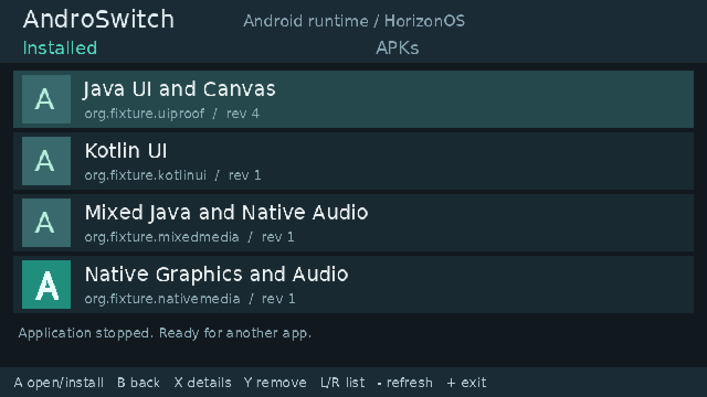

# AndroSwitch

An experimental Android compatibility runtime for **Nintendo Switch HorizonOS**.
The goal is to run unmodified APKs through shared Android API and ABI
implementations, directly from homebrew, without booting a full Android OS.

**Built on [RustyDroid](https://github.com/nadabgfccvd/RustyDroid), created by
[nadabgfccvd](https://github.com/nadabgfccvd) and the RustyDroid contributors.**
Its APK/DEX parsers, Dalvik interpreter, classpath, heap and existing runtime
code are the foundation of this project. AndroSwitch is a history-preserving
fork, with the original copyright notices, licenses and documentation retained.
See [credits and provenance](CREDITS.md) and [NOTICE](NOTICE.md).

## Current status

The latest RustyDroid source is merged at **`3761815`** with its history and
original tests. The [full source audit](docs/UPSTREAM_PORTING.md) tracks all
427 upstream files, reviewed adaptations and original VM sources still excluded
from the device build. **Horizon behavior parity is not yet 1:1 with upstream.**
The isolated `as-vm` package compiles the original RustyDroid source directly,
so desktop Cargo features cannot switch the runner to desktop VM state.
The device build now uses the real Rust standard library through a pinned
Horizon/newlib PAL. Rust `std` and the legacy `desktop-runtime` backend are
independent features; enabling std preserves the Switch's existing JNI,
execution-owner and persistent-storage contracts. See the
[std migration report](docs/HORIZON_STD_MIGRATION.md) for its separate host,
emulator and hardware evidence.
The std probe now passes **32/32 in three consecutive runs**; the combined
NRO passes the available **216 conformance cases**, eleven console sessions,
and normal process exit after graphics/audio. Three emulator PCV queries remain
unrun. The user confirmed **219/219 on physical Switch for the prior std
candidate**; its [receipt](reports/conformance-std-hardware-20261026.json) records
the package context and missing raw device journal/hash. It does not qualify
subsequent binaries, complete API parity or the independent-game first-screen gate.
Latest upstream Arrays/BitSet code and lazy parser improvements now share the
portable path; source synchronization is kept separate from execution evidence.

The complete framework dependency closure now has an experimental
`as-vm/upstream-runtime` reference path using std, the inherited
intrinsic dispatcher and GC, Engine-owned module tables, and native SQLite
instead of a Python subprocess. All 50 original VM integration suites are
registered against that path. **It is not enabled in the shipping runner**:
Horizon services and canonical framework/storage state still require integration.
See the [complete port plan](docs/UPSTREAM_PARITY_PLAN.md) and
[parity checkpoint report](docs/UPSTREAM_PARITY_REPORT.md). SDK declaration
metadata is supplemental type information, not implementation coverage.

The [shared collections/text port](docs/UPSTREAM_COLLECTIONS_TEXT.md) connects
six inherited modules to the product's collection owner, shared heap and
Engine-owned regex state. The duplicate product builder map was removed.
Eighty-four original VM sources remain outside the default device profile;
this is a source inventory, not an API percentage.
Its [checkpoint](reports/collections-text-20261026.json) records 706 reference
tests, 995 product/desktop regressions and 135 JVM/DEX cases passing on host.
The std NRO builds, while its two Collections emulator attempts timed out.
The subsequent [shared GC pressure work](docs/UPSTREAM_GC_PRESSURE.md) reuses
the original adaptive policy and rechecks pinned live watermarks after callbacks
unwind. The ordinary SDK APK's UI/journal now completes **34/34 Collections**
and **30/30 Text** host cases at the unchanged 64 MiB heap. These scoped results
also pass in two completed headless Ryujinx runs of NRO `5876341`, including
return to the launcher and original SD restoration. See the
[retained checkpoint](reports/gc-pressure-20261027.json). These results do not
qualify complete upstream behavior or physical hardware.

The current [collector integration](docs/UPSTREAM_GC_SHARED.md) also removes
the separate product collector. Both profiles compile original RustyDroid GC,
with product roots and platform side-state adapters. Its host verification has
710 reference tests, 1,001 product/desktop regressions, the five unchanged
upstream heap scenarios and the same UI/JVM checks passing. Its new std NRO also
completes the available SDK corpus in two guarded headless Ryujinx launches:
**254 PASS, 3 NOT_RUN**, with safe launcher return and SD restoration. See the
[shared collector receipt](reports/gc-shared-20261027.json). The three missing
PCV clock observations and physical testing of this binary remain open.

A single [AndroSwitch Conformance APK](fixtures/conformance/README.md) now groups
274 original sensor-free Java, Android, JNI and graphics tests. Run all, resume,
inspect results and export JSON from one installation. See [scope and actual
platform observations](docs/CONFORMANCE_SUITE.md); this is not official CTS or
complete Android coverage.

The following [shared I/O integration](docs/UPSTREAM_SHARED_IO.md) connects
inherited File/stream/AtomicFile algorithms to persistent storage and compiles
the original character/byte streams on the default std VM. Its larger SDK has
148 JVM oracle rows and seventeen I/O contracts. Native descriptor/lock and
complete platform/state integration remain open; this is not full API parity.

Earlier 219-case unified-SDK Ryujinx baseline: **216 PASS, 3 NOT_RUN** across 20 sessions.
The user subsequently confirmed **219/219 PASS on a physical Switch**; see the
[hardware feedback record](reports/conformance-hardware-20261025.json). The emulator
keeps three clock queries NOT_RUN because its PCV command is absent. All nine GLES and six Vulkan
discovery/device cases pass; Vulkan rendering/presentation is outside these six
cases. The 219-case hardware result is user-reported; its raw device journal has not
yet been archived. See the
[recorded results](reports/conformance-mesa-20261025.json) and
[optional Mesa integration](docs/MESA_SWITCH_PORT.md).


**M9 validation candidate: one `androswitch.nro`, one SD folder.** The console
installs, updates and launches supported APKs using the shared RustyDroid
interpreter and native ARM64 backend. Java/Kotlin UI, NativeActivity GLES2,
assets, PCM audio and repeated application switching have Ryujinx evidence.
The user reports that the four bundled APKs open on a physical Switch, including
native animation/beeps, and that the display handoff fix resolves the native
Plus crash and startup stall. This is sample-level user feedback; see
[hardware feedback](docs/HARDWARE_FEEDBACK.md).
The user has also confirmed M1–M7 testing on physical Switch. In a later M7–M9
candidate test, an APK larger than 65 MB installs, SQLite is readable and
SharedPreferences works. Subsequent hardware logs admit Candy Crush's DEX files
and expose missing startup APIs. Ryujinx reproduces those failures; shared Enum,
native property and display improvements advance startup further. An original
portrait fixture renders real 720x1280 EGL buffers and returns cleanly to the
launcher. Mekorama and Candy Crush still have **no first-screen compatibility
pass**. See [M9 independent-app work](docs/M9_EXTERNAL_APPS.md) and the separate
[display evidence](docs/HORIZON_DISPLAY.md). The earlier 67-check baseline and
subsequent scoped checks are recorded separately from new changes; independent-game
compatibility gates remain open.
The current [upstream reuse work](docs/UPSTREAM_REUSE_AUDIT.md) shares RustyDroid's
primitive wrapper module between desktop and device, with 86 JVM observations
passing on both paths. Existing upstream code is audited before new API work.
Android logging dispatch is also extracted from upstream into one shared
module, with host output and Horizon file storage supplied by adapters.
Shared startup work now includes numeric/reference atomics, class loaders,
package/provider metadata, local Binder, Locale, constructor reflection, JNI static
fields and owned native anonymous memory/FILE descriptors. See the
[exact retest record](reports/m9-atomic-loader-provider-20261025.json). The earlier
219-case hardware result does not verify these new binaries.
M8 adds persistent XML SharedPreferences, native SQLite, boxed collections and
DEX method reflection. M9 adds a repeated host corpus, external APK evaluation
and startup/frame/heap measurements. See [exact evidence and limitations](docs/M8_M9_E2E.md).
This is a candidate, not the completed v0.1 compatibility release.



Actual submitted console framebuffer from the M7 Ryujinx test.

| Area | Verified status |
| --- | --- |
| Host APK inspection | Manifest, resources, DEX/native inventory and SDK/ABI/split preflight |
| Portable APK/DEX core | Shared parsers and interpreter build for the freestanding ARM64 Switch target |
| Persistent packages/storage | Copied APKs, immutable update revisions, isolated saves, uninstall retention and OBB streaming |
| Native ARM64 | Program-header ELF loader, dependencies, constructors, supported relocations/TLS and real libnx execution |
| JNI | Native registration, callbacks/reentry, strings, primitive arrays, exception/reference/GC and pthread callback proof |
| Ryujinx E2E | DEX semantics, persistent storage, native CPU oracle and mixed Java/Kotlin JNI fixtures; see milestone evidence |
| Merged upstream VM regression | 710 std-reference tests pass, with all 50 original integration routes; native/JIT zero-case targets remain unverified; device API parity is separate |
| Android lifecycle/UI | Supported M5 subset; 14 Java/Kotlin UI snapshots pass in Ryujinx |
| Native graphics/audio | NativeActivity, incremental assets, input queue, EGL/GLES2; Java AudioTrack, AAudio writes and OpenSL ES PCM queue callbacks |
| Console launcher | Scan/install/update/launch/return/uninstall; persistent saves, named failures and one NRO |
| Physical Switch | User reports sample install/open, native animation/beeps, safe native Plus return; later candidate: large APK install, SQLite and SharedPreferences working |

The launcher is usable for the supported test corpus. Arbitrary apps can still
require missing Android APIs. The M7 improvement source accepts file-backed APKs up to **512 MiB**
on device, API 26 or lower minimum SDK, and ARM64 native libraries. A 128 MiB
container passes host install/launch/restart tests. Large APK installation is
also user-reported on Switch; full device/emulator scenarios remain open.
DEX admission now accounts for raw and decoded metadata under a load-dependent
parser budget (up to 256 MiB), with a separate raw ceiling up to 128 MiB. The
heap honors loader-provided bounds or measured process capacity; 256 MiB was
the previous default, not a guaranteed hardware heap size. Native materialization
has its own budget. See [memory policy](docs/HORIZON_MEMORY.md). OBBs stream separately.
Network, Google Play Services, split APKs, WebView and modern
engine compatibility are not established. There is no per-game configuration.
Inherited RustyDroid capabilities are not automatically Switch capabilities.
Read the [compatibility inventory](docs/ANDROSWITCH_COMPATIBILITY.md) and
[M2–M4 implementation and evidence guide](docs/M2_M4_E2E.md) for the exact scope.
Shared C++ ABI support advances both games beyond their original startup
blockers. The latest emulator attempts pass monitor, Timer, Executor, resource,
Bitmap, JNI constructor and Thread identity blockers. Independent SDK APKs
verify actual workers, native-suspended GC roots, PNG pixels and JVM-matching
JNI constructor/thread/context results. Independent SDK APKs also verify
installed package metadata and actual worker ThreadLocal isolation in Horizon.
The next SDK proofs verify COW snapshots, DEX field reflection and TimeUnit
conversions on one NRO. The most recent pre-sync attempts and exact artifact hashes are recorded in
[the reuse evidence](reports/m9-upstream-reuse-20261026.json). They are historical
results for those binaries, not a first-screen pass for the merged source.
Neither game has a first-screen compatibility pass.
See [the two-game observations](reports/m9-input-runtime-startup-ryujinx-20261025.json)
and [the later Runtime/Mekorama run](reports/m9-runtime-resources-horizon-20261025.json).
Installation is not a compatibility guarantee; see
[startup-failure diagnosis and recovery](docs/STARTUP_FAILURES.md).
See [M7 storage improvements](docs/M7_STORAGE_E2E.md) for the new I/O path and limits.

## Project direction

- One common Android environment: improve shared API/ABI contracts instead of
  adding package-name branches, game profiles or title-specific hooks.
- DEX interpretation and native ARM64 libraries connected
  through real JNI objects, methods and references.
- A portable core with core/alloc interfaces, real Horizon std and explicit libnx adapters.
- Offline, one-app-at-a-time operation for the first release; no Python,
  Unicorn or guest Linux kernel in the device build.
- A console launcher with an installed-app list and persistent Android-style
  storage. Network support and split APKs follow the initial offline release.

Android API 26 is the initial behavior reference. An APK with `minSdk <= 26`
may enter evaluation; `targetSdk` is not a minimum requirement. Passing these
static checks does not establish Android API coverage or app compatibility.

## Use the Switch package

Extract the development ZIP's `switch/` folder to the SD card. Open
`switch/androswitch/androswitch.nro` through homebrew application/title override.
The M9 candidate includes seven sample APKs, ready to install from the APKs
list. Put additional single APK files in `switch/androswitch/apks/`.

- **L/R:** Installed/APKs list. **A:** launch or install/update. **B:** back.
- **X:** details. **Y:** uninstall with saved data retained. **ZR:** separate
  clear-internal-data action. Both deletion actions require confirmation.
- **Minus:** rescan. **Plus:** return from an app to the console; from the
  console, exit homebrew. Touch selects a row; tap it again to open it.

If native workers cannot stop safely, the runtime records the reason and exits
the Horizon process. Reopen homebrew to read the interruption notice; it does
not reuse live guest code. APKs run native code in the homebrew process, so
install APKs you trust. See [using AndroSwitch](docs/USING_ANDROSWITCH.md),
[the Indonesian quick start](docs/QUICK_START_ID.md) and
[M6/M7 scope and evidence](docs/M6_M7_E2E.md).

## Try the host tools

Requires Git and Rust/Cargo. The repository pins Rust **1.97.1** in
[rust-toolchain.toml](rust-toolchain.toml). Windows PowerShell commands:

```powershell
git clone https://github.com/BlekjekSudo/androswitch.git
cd androswitch
cargo run -p as-cli --locked -- capabilities --json
cargo run -p as-cli --locked -- inspect "path/to/app.apk" --json
```

To inspect the checksum-pinned real APK fixture:

```powershell
./scripts/fetch-fixtures.ps1 -ExtractDex
cargo run -p as-cli --locked -- inspect fixtures/cache/org.fdroid.fdroid_2000052.apk --json
./scripts/check-m0.ps1
```

`asctl` provides inspection and persistent package management:

```powershell
cargo run -p as-cli --locked -- install "path/to/app.apk" --root "local-artifacts/storage" --json
cargo run -p as-cli --locked -- list --root "local-artifacts/storage" --json
```

The DEX/JNI execution probe is a separate development harness; application
lifecycle execution flags in `asctl` remain false until that integration exists.
See the
[CLI reference](docs/CLI.md) and [getting started guide](docs/GETTING_STARTED.md).

## Build the product NRO

The product uses the same portable core as the earlier proofs, plus libnx,
Switch Mesa EGL/GLES2 and PCM output. See [building](docs/BUILDING.md) for
prerequisites and [M6/M7](docs/M6_M7_E2E.md) for exact checks.

```powershell
./scripts/build-m5-fixture.ps1
./scripts/build-m6-fixture.ps1
./scripts/build-m8-fixture.ps1
./scripts/build-aosp-hello.ps1
./scripts/test-m9-host.ps1
./scripts/build-androswitch.ps1
# Desktop emulator execution is a separate explicit opt-in; see M8/M9 guide.
# After recording this build's evidence:
./scripts/package-androswitch.ps1 -Stage m9-candidate -EvidencePath reports/m8-m9-candidate.json
```

Output: `local-artifacts/product/androswitch.nro` and a copy-ready ZIP under
`local-artifacts/releases/`. APKs and compiled binaries are generated locally;
they are not committed to the source repository.

## Reproduce the earlier Switch proof

The current NRO build uses Windows Rust, WSL Ubuntu with devkitPro/libnx,
PowerShell 7, a JDK and Android SDK build-tools/platform 35. The device Rust
toolchain is pinned to nightly-2026-08-26. Full setup and commands are in
[building](docs/BUILDING.md).

```powershell
./scripts/build-switch-smoke.ps1 -Toolchain nightly-2026-08-26
./scripts/test-ryujinx-m1.ps1 -SkipBuild -Ryujinx "D:/path/to/Ryujinx.exe"
./scripts/check-m1.ps1 -SkipFixtureBuild
```

The E2E runner builds the fixture and NRO, generates a fresh session, reads
actual emulator SD reports, compares them to the portable host and JVM, and
stops only its own emulator process. Outputs stay in ignored
`local-artifacts/m1/`; compact evidence and fixture source hashes are tracked.
See [testing](docs/TESTING.md) and the [M1 E2E procedure](docs/M1_E2E.md).

## SD layout

The console creates the directories below on first boot. Installation keeps
its own APK copy, so the source in `apks/` can be moved after installation.
The earlier developer proofs use a separate `androswitch-smoke/` input folder.

```text
switch/androswitch/
├── androswitch.nro
├── runtime/
├── apks/
├── Android/
│   ├── data/<package>/
│   └── obb/<package>/
├── DCIM/
├── Download/
├── installed/<package>/
├── userdata/<package>/
├── cache/
└── logs/
```

Java and native file APIs share the same filesystem mappings. Put OBB files in
`Android/obb/<package>/`; they remain ordinary app-readable files and are not
automatically extracted. Private saves live in `userdata/<package>/`.

## Documentation and development

- [Documentation index](docs/README.md): setup, build, CLI, tests and design.
- [Roadmap](docs/ANDROSWITCH_ROADMAP.md): M0–M12 and separate host/emulator/device gates.
- [Architecture](docs/ARCHITECTURE.md): core, platform boundary, storage and lifecycle.
- [Compatibility inventory](docs/ANDROSWITCH_COMPATIBILITY.md): implemented behavior and remaining work.
- [Contributing](CONTRIBUTING.md): shared-contract fixes, evidence and review requirements.
- [Security](SECURITY.md): reporting issues in this fork.

The original [RustyDroid README](README.rustydroid.md),
[specification](RustyDroid.md), roadmap and `rd` tools are retained as upstream
material. Their Linux/headless/MCP claims and performance budgets describe
RustyDroid, not verified Horizon behavior. The full immutable upstream baseline
has known failures, recorded in [M0 baseline](docs/M0_BASELINE.md).

## Credits and license

Primary credit belongs to **nadabgfccvd and the RustyDroid contributors** for
the original runtime. AndroSwitch builds on their implementation; the Switch
port, platform integration, development harness and its compatibility evidence
are maintained in this repository.

The fork starts at RustyDroid commit
[`6388281f66d254c8e01a0fdc7a5a9a30239bc762`](https://github.com/nadabgfccvd/RustyDroid/commit/6388281f66d254c8e01a0fdc7a5a9a30239bc762).
The original Git history and license texts are preserved. The project and
AndroSwitch additions use **MIT OR Apache-2.0**, at your option:
[MIT](LICENSE-MIT), [Apache-2.0](LICENSE-APACHE), [NOTICE](NOTICE.md).
Other components retain their respective licenses; see [CREDITS](CREDITS.md).
